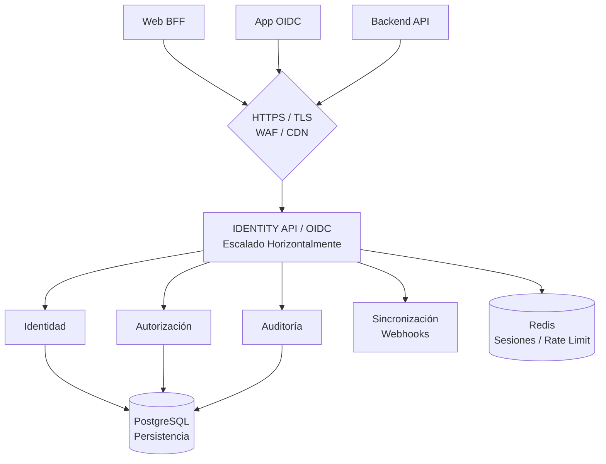

# API Central de Identidad — Documento Maestro para Codex

**Proyecto:** Identity API
**Objetivo:** construir un servicio centralizado de autenticación, identidad y autorización para aplicaciones web, backends y productos SaaS multiempresa.
**Estado inicial:** repositorio nuevo, sin código preexistente.
**Tecnologías principales:** Node.js, TypeScript, PostgreSQL (SQL explícito), Redis y OpenTelemetry.
**Metodología:** implementación incremental por fases, pruebas reproducibles desde la terminal y aprobación humana antes de continuar.

---

## 0. Instrucciones generales para Codex

### 0.1. Rol que debe asumir Codex
Actuá como ingeniero de software senior especializado en seguridad de aplicaciones, arquitectura backend, autenticación federada, OAuth 2.0, OpenID Connect, PostgreSQL, sistemas distribuidos y pruebas automatizadas.
Tu tarea es construir una API central de identidad reutilizable, con criterios de seguridad apropiados para un servicio que podría convertirse en un componente crítico de múltiples aplicaciones.
No te limites a generar código que compile. Debés implementar controles de seguridad, pruebas, documentación técnica y verificaciones reproducibles.

### 0.2. Regla fundamental: trabajar por fases
No implementes todo el proyecto de una sola vez.
Debés trabajar siguiendo este procedimiento:
1. Leer este documento completo y comprender los requisitos.
2. Identificar la fase autorizada para implementar.
3. Revisar el estado real del repositorio y las herramientas instaladas.
4. Implementar exclusivamente el alcance de esa fase.
5. Ejecutar las pruebas y comprobaciones correspondientes.
6. Corregir los errores encontrados.
7. Informar qué archivos creaste o modificaste, qué comandos ejecutaste y cuáles fueron sus resultados.
8. Indicar los criterios de aceptación cumplidos y pendientes.
9. Detenerte y esperar la aprobación explícita del usuario antes de comenzar la siguiente fase.

### 0.3. Reglas de seguridad no negociables
- No afirmes que el sistema es invulnerable o completamente seguro.
- No implementes criptografía propia.
- No implementes manualmente el protocolo OAuth 2.0 u OpenID Connect.
- No almacenes contraseñas en texto plano ni mediante hashes rápidos como SHA-256.
- No guardes tokens de acceso, refresh tokens, contraseñas o secretos en logs.
- No uses secretos fijos en el código.
- No permitas que una aplicación acceda a otra organización por conocer o modificar un identificador.
- No confíes en datos de identidad, roles o permisos enviados por el navegador.
- No desactives controles de seguridad para conseguir que una prueba pase.
- No utilices datos reales de usuarios en las pruebas.
- No afirmes que una vulnerabilidad está resuelta sin comprobar el control correspondiente.
- No despliegues ni expongas el servicio públicamente sin autorización expresa.

Todas las decisiones de seguridad importantes deben quedar documentadas.

---

## 1. Visión y alcance del producto

### 1.1. Qué estamos construyendo
Construiremos un servicio centralizado que permita que distintos proyectos deleguen la autenticación de sus usuarios en una infraestructura común.
El producto deberá admitir:
- Registro e inicio de sesión mediante correo electrónico y contraseña.
- Inicio de sesión federado mediante Google.
- Autorización de aplicaciones registradas (OAuth 2.0 / OIDC).
- Gestión de sesiones y tokens (soportado por caché distribuida).
- Integración segura con dashboards mediante un patrón Backend for Frontend (BFF).
- Identidades globales compartidas e internacionalización (i18n) para correos y pantallas.
- Organizaciones, membresías y roles propios de cada organización.
- Auditoría de eventos relevantes de seguridad y observabilidad distribuida.
- Emisión de eventos (Webhooks/Event Bus) para sincronización de estados con otros backends.
- Cumplimiento normativo (GDPR/CCPA) mediante flujos de exportación y anonimización de datos.

### 1.2. Qué no vamos a construir inicialmente
El alcance inicial no incluye panel administrativo gráfico, plataforma de facturación SaaS, ni un sistema universal de permisos genéricos.

---

## 2. Arquitectura objetivo

### 2.1. Componentes principales
1. API HTTP para operaciones propias del producto.
2. Proveedor OpenID Connect basado en una biblioteca especializada.
3. Módulo de identidad y credenciales.
4. Módulo de clientes OAuth/OIDC.
5. Módulo de organizaciones y membresías.
6. Módulo de autorización.
7. Módulo de sesiones, tokens y limitación de rango (soportado por Redis).
8. Módulo de eventos y auditoría (Webhooks y OpenTelemetry).
9. Adaptador de persistencia PostgreSQL mediante SQL explícito.
10. Adaptador de correo deshabilitado por defecto.
11. Módulo de configuración y gestión de secretos.

### 2.2. Diagrama conceptual

---

## 3. Stack tecnológico

### 3.1. Tecnologías obligatorias
- Node.js LTS, TypeScript estricto, Express 5.
- PostgreSQL y biblioteca `pg` (sin ORM).
- Redis (ej. `ioredis`) para rate limiting y almacenamiento efímero distribuido.
- Biblioteca OIDC (`oidc-provider` o similar).
- `zod`, `argon2`, `vitest`, `supertest`.
- OpenTelemetry para trazabilidad distribuida.
- Biblioteca de internacionalización (ej. `i18next`).

---

## 4. Modelo de identidad, aislamiento y privacidad

### 4.1. Identidad global y Privacidad (GDPR/CCPA)
El diseño debe contemplar el "derecho al olvido". Documentar e implementar la diferencia entre borrado lógico (desactivación) y borrado físico.
Al eliminar una cuenta, los datos personales en tablas de auditoría deben ser anonimizados. Se debe proveer una estructura para que el usuario pueda solicitar la exportación de sus datos.

### 4.3. Reglas de integridad
Las operaciones que requieran consistencia deberán ejecutarse en transacciones PostgreSQL.
Los estados (activo, suspendido, pendiente) deben ser explícitos.

---

## 5. Diseño de autenticación y protocolos

### 5.1. OAuth 2.0 y OpenID Connect
La biblioteca OIDC gestionará los flujos. El almacenamiento efímero (como códigos de autorización y nonces) debe apoyarse en Redis para permitir escalabilidad horizontal.

---

## 6. Contraseñas, sesiones y limitación de intentos

### 6.2. Intentos de autenticación
Implementar limitación de intentos (Rate Limiting) robusta usando Redis. No depender de contadores en memoria RAM del proceso Node.js, ya que el sistema tendrá múltiples instancias.

### 6.3. Sesiones web y Soporte i18n
Las cookies deben ser Secure, HttpOnly y SameSite.
Los endpoints de autenticación y recuperación deben leer cabeceras `Accept-Language` para renderizar errores o correos en el idioma del usuario.

---

## 8. Validación, errores y seguridad HTTP

### 8.2. Respuestas de error
Deben estar estandarizadas e internacionalizadas (i18n). No devolver stack traces ni datos internos.

---

## 10. Auditoría, Observabilidad y Sincronización

### 10.1. Eventos de auditoría
Registrar eventos sin guardar datos sensibles. Anonimizar datos si un usuario ejerce su derecho al olvido.

### 10.2. Trazabilidad Distribuida (OpenTelemetry)
Implementar OpenTelemetry. Cada petición debe generar un Trace ID que viaje desde el WAF/BFF, pase por la API y quede registrado en los logs estructurados, permitiendo rastrear errores en entornos distribuidos.

### 10.4. Sincronización de Estados (Webhooks)
Definir un mecanismo (Event Bus interno o Webhooks) para notificar a los backends consumidores cuando una identidad cambia (ej. `user.created`, `user.deleted`, `membership.revoked`). La API de identidad es la fuente de verdad y debe empujar estos cambios.

---

## 12. Plan de implementación por fases

### Fase 0. Inspección, planificación y decisiones técnicas
**Objetivo:** Preparar el proyecto y validar la viabilidad técnica de las dependencias antes de implementar autenticación.
**Tareas:**
1. Comprobar el estado del repositorio.
2. Comprobar las versiones de Node.js, npm y PostgreSQL disponibles.
3. Seleccionar la versión LTS de Node.js.
4. Verificar la compatibilidad entre Express, TypeScript y la biblioteca OpenID Connect.
5. Verificar el modelo de persistencia que requiere la biblioteca.
6. Identificar los requisitos para integrar Google.
7. Crear un documento de decisiones de arquitectura.
8. Definir cómo se ejecutará PostgreSQL localmente.
9. Definir las convenciones de pruebas y migraciones.
10. Identificar riesgos técnicos pendientes.

### Fase 1. Estructura base, calidad de código y CI
**Objetivo:** Crear un backend mínimo y configurar Integración Continua.
**Tareas añadidas:**
11. Configurar pipeline de CI (ej. GitHub Actions) que bloquee merges si fallan tests, lint o typecheck.

### Fase 2. Infraestructura: PostgreSQL y Redis
**Objetivo:** Crear la persistencia y la capa de caché/rate limit.
**Tareas añadidas:**
8. Configurar cliente de Redis.
9. Implementar lógica básica de reconexión para Postgres y Redis.

*(Las Fases 3 a 12 continúan según la estructura inicial, asegurando incluir i18n, OpenTelemetry y Webhooks donde corresponda en sus respectivas áreas)*

### Fase 13. Preparación y revisión de producción
**Objetivo:** Preparar el servicio para un despliegue controlado.
**Tareas añadidas:**
17. Requerir explícitamente el uso de un WAF (Web Application Firewall) o CDN en el borde para mitigar DDoS antes de llegar a Node.js.
18. Validar el funcionamiento de OpenTelemetry y exportación de logs centralizados.

---

## 16. Forma de trabajo y reporte de cada fase

Al terminar cada fase, Codex debe presentar un informe con este formato:
- **Fase completada**
- **Objetivo:** descripción breve.
- **Archivos creados o modificados:** listado con explicación.
- **Decisiones técnicas:** decisiones tomadas y justificación.
- **Comandos ejecutados:** comandos reales.
- **Resultados:** resultados de cada prueba, distinguiendo éxito, fallo y prueba no ejecutada.
- **Criterios de aceptación:** cuáles se cumplieron y cuáles están pendientes.
- **Riesgos detectados:** riesgos o limitaciones que todavía deben resolverse.
- **Cómo probarlo manualmente:** instrucciones concretas para reproducir las verificaciones.
- **Estado:** lista para revisión o bloqueada por problemas pendientes.

*Después del informe, detenerse y esperar autorización. No continuar con la siguiente fase hasta recibir aprobación explícita.*

---

## 17. Lista de verificación final de seguridad

Además de la seguridad básica (Argon2id, SQL parametrizado, validación de inputs, OIDC, etc.), verificar:
- [ ] Rate Limiting centralizado implementado usando Redis.
- [ ] Trazabilidad distribuida (OpenTelemetry) operativa.
- [ ] Flujos de borrado/anonimización de datos (GDPR) documentados/implementados.
- [ ] Notificación a servicios externos (Webhooks) implementada para cambios de estado críticos.
- [ ] API protegida teóricamente por WAF en la arquitectura de despliegue.
- [ ] Pipeline de CI/CD exigiendo paso de pruebas y linting.

---

## 18. Primera instrucción para iniciar el trabajo

**Codex:** comenzá únicamente por la **Fase 0**.
Primero revisá las herramientas disponibles, verificá las dependencias críticas (PostgreSQL, Redis, oidc-provider), proponé las decisiones de arquitectura necesarias y generá los documentos iniciales.
Presentá el informe de la Fase 0 y detenete para revisión humana.
Fin del documento maestro.